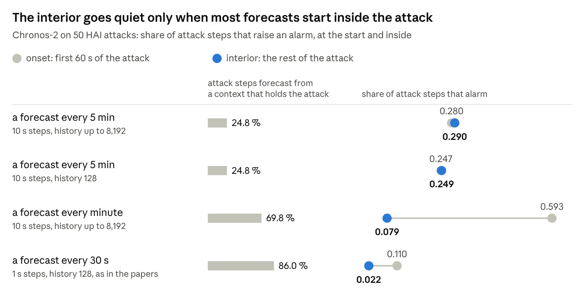
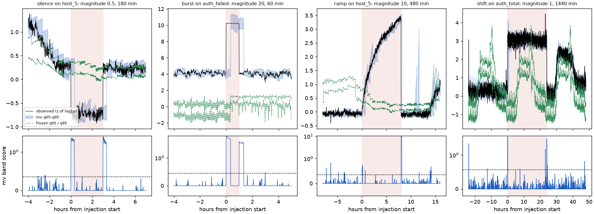

# Time Series Foundation Model detectors are change detectors, like any rolling forecast

Oct 21, 2026 · Arthur Rapp

When Mistral released Timestral, a time-series foundation model, I wanted to know whether models like it could work as anomaly detectors in security. What surprised me was that the simplest possible forecast, repeating the last value, stops alarming during a long attack just like the foundation model. What went wrong were my fixes: each one I tried, including the one a paper proposes, caught more of the attack but raised many more false alarms.

Time-series foundation models promise anomaly detection without training data. You point a pretrained forecaster at a new series, and every observation outside the forecast band becomes an alarm. Two papers this year suggest these detectors get used to an attack ([Uray et al. 2026](https://arxiv.org/abs/2607.12454); [Lowe, Fung and Bauer 2026](https://clementfung.github.io/gallery/papers/fmsd26-tsfm.pdf)). The forecast error spikes when an attack starts, then collapses inside a long attack, because the model reads the attack in its context and forecasts it faithfully.

I ran Chronos-2, a zero-shot time-series foundation model, as an anomaly detector on industrial control data and on enterprise authentication logs. On the logs it flagged when an anomaly started and when it ended, and stayed almost silent in between. On the industrial data the same gap appeared only when new forecasts started.

The simplest baseline, the last value (a forecast that simply repeats the most recent observation), gets used to an attack in the same way. On the logs it alarms on 31.6 % of the minutes in the first half hour of each anomaly, but on only 1.8 % of the minutes after that. So any forecaster that keeps updating on recent data (a rolling forecast) does this, foundation model or not. What Chronos-2 adds is fewer false alarms: 6.7 a day per series on the logs, against 11.0 for the last value.

## How I tested it

I kept the detector as plain as the papers describe it, and held every threshold to normal data only.

**The data.**

- **HAI 21.03:** a boiler, a turbine and a water-treatment process, 79 sensor and actuator tags at 1 s, 50 labelled attacks of 17 seconds to 7 minutes. I downsampled to 10 s and z-scored each channel on training files only.
- **LANL:** 13 per-minute series built from 1.05 billion authentication events: tenant totals, the 5 busiest destination computers and the 5 busiest source hosts. In the last 17 days I injected log silences, brute-force bursts, slow ramps and baseline shifts, from 10 minutes to 24 hours long.

**The model.** Chronos-2 is Amazon's time-series foundation model (119M parameters, Apache 2.0). I ran it zero-shot at a pinned revision on an Apple M5. It returns 21 forecast quantiles directly, with no sampling.

**The loop.** H is the horizon: how many steps one forecast covers. Every H steps, the model forecasts the next H steps from up to 8,192 steps of history, never the future, then each observation is scored against its forecast band. With H = 30 that is a new forecast every 5 minutes on HAI (10 s steps) and every 30 minutes on LANL (1-minute steps).

**The score.** How far an observation falls outside the forecast band (the 5 % to 95 % forecast percentile), measured in band widths: 0 inside the band, 1 a full band width outside it. On HAI each channel is forecast on its own, and the three highest channel scores are averaged into one score per step; on LANL each series is scored on its own.

**The threshold.** Before any test, I scored a stretch of normal calibration data and put the threshold at its 99.5th percentile: the score that only the highest 0.5 % of normal steps exceed. On normal data the detector therefore alarms on about 1 step in 200, on purpose. That is about 1.8 alarm steps per hour on HAI and about 7 per series per day on LANL. No threshold, horizon or score was tuned on test labels.

**What I measured.**

- **ROC-AUC:** the chance that a random attack step scores higher than a random normal step. 0.5 is a coin flip, 1.0 is perfect.
- **PR-AUC:** of the steps that alarm, how many are attacks, over every threshold. Its chance level is the share of attack steps (0.024 on HAI), so with rare attacks it is the stricter of the two.
- **[TaPR](https://github.com/saurf4ng/TaPR):** precision and recall for time series that score each attack as a range: did an alarm hit it, and how much of it was covered. I used the official code, unmodified.
- **Onset, interior and offset:** each anomaly split into three segments: its first minutes (60 s on HAI, 30 minutes on LANL), the rest, and the same span after it ends.
- **Coverage:** the share of a segment's steps that alarms.

For every step I also recorded whether its forecast started before or after the anomaly began, that is, whether the model had already read the anomaly.

**The baselines** get the same scoring: the last observed value, the same time on a reference day, and the median of the last hour. Each uses a band from how much the series normally changes.

## What happens inside an anomaly

On HAI only 1 of the 231 interior attack steps whose forecast context already held attack data raised an alarm. Of the 406 interior steps forecast from clean context, 36.7 % alarmed.

To check that the model *can* see those 231 steps as anomalous, I forecast the same steps from the clean context that ended at the attack onset, and scored them against the same threshold. Then 45.9 % of them alarm. The model sees these steps as anomalous from a clean context but after it has read the attack, it stops.

This is the mechanism both papers describe. **The model does what it was trained to do: it continues the pattern it is given.** An attack that has been running for two minutes is, to a forecaster, simply the latest pattern.

## How often a new forecast starts

On HAI a new forecast starts every 5 minutes and no attack lasts longer than 7 minutes, so 33 of the 50 attacks fall entirely inside a forecast made before they started. Only 24.8 % of attack steps are forecast from a context that already holds the attack (contaminated). With so little contamination, the interior alarms about as often as the onset (coverage 29.0 % against 28.0 %, averaged over the 50 attacks), and the shape the papers predict does not show.

The contaminated share depends on how often a new forecast starts compared with the attack length. Take a 3-minute attack that begins just as a forecast starts. With a new forecast every 5 minutes, the whole attack is forecast from before it began, so nothing is contaminated. With a new forecast every minute, the forecasts at minutes 1 and 2 already hold attack data, so two thirds of the attack is contaminated. The share follows from the labels and the forecast schedule alone, so I can compute it before running any model.

To test this, I kept the model, the data and the threshold rule, and changed the forecast setup. The chart compares four settings:

1. **A new forecast every 5 minutes** (H = 30 at 10 s steps, history up to 8,192 steps): the HAI setup in the rest of this post.
2. **The same with a 128-step history:** a control for the history length.
3. **A new forecast every minute** (H = 6): each forecast covers the minute until the next one starts, so the horizon shrinks too.
4. **A new forecast every 30 s at 1 s steps, with a 128-step history:** the papers' setting. Making a new forecast starts inside the 60 s onset, so part of the onset is already contaminated.

*Chronos-2, one channel at a time, band score at the calibration threshold · 50 HAI 21.03 attacks · onset = first 60 s*

The interior goes quiet only when the contaminated share is high. With a new forecast every minute, 69.8 % of attack steps are contaminated: onset coverage doubles to 59.3 % and interior coverage drops from 29.0 % to 7.9 %. In the papers' setting (86.0 %), interior coverage is 2.2 %. There, only 28.3 % of attacks get any alarm inside their interior, fewer than the 45.1 % that random alarms at the same rate would hit.

*Note:* the history length is not the cause. Cutting the history 64-fold lowered ROC-AUC from 0.894 to 0.853 but left the shape unchanged.

Restarting often works, but it has a cost. With a new forecast every minute, 47 of 50 attacks get at least one alarm, against 31, because a fresh forecast catches more onsets. However, ROC-AUC falls from 0.894 to 0.817, and the end of an attack is caught less often (offset coverage 2.7 % against 8.3 %). With frequent restarts, only the start of an attack stands out.

## Long anomalies in authentication logs

On LANL the anomalies last 10 minutes to 24 hours against a 30-minute forecast, so the contaminated share is high: most of each anomaly is forecast from a context that holds it.

Over all 144 injected anomalies, Chronos-2 covered 36.4 % of the onset minutes and 28.8 % of the 30 minutes after the end. Inside the anomalies it covered 0.4 %, no more than its alarm rate on normal minutes (0.5 %). The interior is invisible. The last value shows the same shape (onset 31.6 %, interior 1.8 %, offset 28.4 %). The median of the last hour drops less, but still sharply (54.9 % at the onset, 8.0 % inside).

*The forecast band (blue) catches up with each new level within one 30-minute forecast, so the score (bottom row) crosses its threshold (dashed) mainly where an anomaly starts and where it ends. Left to right: a 3-hour silence, a 1-hour brute-force burst, an 8-hour ramp and a 24-hour shift.*

The slow changes show it most clearly:

- **Slow ramp** (one host's login activity rising linearly for 2 or 8 hours). Onset coverage 6.9 %, interior 0.7 %. Of the 29 detected ramps, 7 alarm only when the ramp drops back to normal, after it is over.
- **Baseline shift** (+20 % to +100 % for 6 or 24 hours on total logins or one DC-like server). 26 of the 31 detected shifts alarm within 30 minutes of the step. After that the new level is normal: interior coverage 0.2 %.

Even a brute-force burst is a change event to the model. Bursts of failed logins were detected 35 of 36 times, but inside a 60-minute burst there was no alarm after its first 30 minutes (interior coverage 0.0 %).

For an analyst, the alert says something changed at 09:00. Within 30 minutes the dashboard is green again, although the shifted level is still there. A change detector therefore needs a layer on top: an alert that stays open until the level returns.

## Detection rates and their chance level

My first LANL tables looked good: Chronos-2 "detected" 128 of 144 anomalies, and 88.9 % of the 24-hour shifts. Both numbers mean much less than they seem.

An anomaly counted as detected if at least one alarm fell inside it or in the 30 minutes after it. But the detector also raises about 7 false alarms a day per series, so a long anomaly usually catches one of them, attack or not. To measure this, I took stretches of normal data of the same length from the same series and counted how often they would also count as "detected". For 24-hour shifts that happens 83.8 % of the time, so the model's 88.9 % is barely better than chance.

| anomaly | detected | by chance alone |
| --- | --- | --- |
| brute-force burst, 10 min | 94.4 % | 10.0 % |
| silence, 30 min | 88.9 % | 14.7 % |
| ramp, 8 h | 88.9 % | 68.9 % |
| shift, 24 h | 88.9 % | 83.8 % |

The detector works for short anomalies, but not for long ones. For those, onset coverage and the time to the first alarm are the better evidence.

## Three ways to protect the context

If the problem is that the anomaly enters the context, the obvious fix is to keep it out. Lowe et al. propose one way, Forecast Fallback; I added two of my own, a frozen reference and a dual score. Each one bought back some of the interior, and each one paid for it in false alarms.

| method | how it protects the context | interior coverage (LANL) | false alarms per series-day (LANL) |
| --- | --- | --- | --- |
| rolling forecast | none | 0.4 % | 6.70 |
| Forecast Fallback | replaces suspicious observations with the model's own forecast | 31.2 % | 254.95 |
| frozen reference | forecasts from one fixed clean day, per time of day | 31.3 % | 41.83 |
| dual | scores the gap between rolling and frozen forecasts | 34.0 % | 47.48 |

**Forecast Fallback** is the fix Lowe et al. propose. After 3 consecutive steps above a feature's 99.5th-percentile error, the forecast replaces the observation in the context. The paper released no code, so mine is an interpretation of the text. On HAI I ran it only with all channels of a process forecast together. There it raised 116.5 false-alarm steps per hour, against 1.1 for the plain forecast on the same setup.

**Frozen reference** never adapts, so it keeps seeing the anomaly. It also keeps seeing normal drift: its reference day ages over 17 test days, and on one busy host it raised 302 false alarms a day.

**Dual** does not look at the observation at all. It compares two forecasts, the rolling one and the frozen one, and alarms when they disagree, because then the recent history has moved away from the clean day. It inherits the frozen reference's ageing: 47.48 false alarms per series-day, and only 82 of 144 anomalies detected.

A reference that refuses to learn the anomaly also refuses to learn normal change. The detector cannot tell the two apart, and that is the detection problem itself.

**When to use this:** a protected or slow reference makes sense as a second, slower channel next to the rolling one. It works when normal behaviour is stable, the reference is refreshed from data you have verified as clean, and you accept its higher false-alarm rate on that channel.

## Chronos-2 against simple baselines

Chronos-2 forecasts normal HAI data well: its typical error is 23.7 % smaller than simply repeating the last value (0.388 against 0.508 standard deviations). But better forecasts did not catch more attacks.

- **Against the last value:** both rank attacks about equally well. PR-AUC is 0.401 against 0.412, a difference of −0.011 with a 95 % interval of −0.131 to +0.100. The last value even scores better on TaPR F1 (0.554 against 0.398).
- **Against a smaller model:** chronos-2-small, a quarter of the size (28M parameters against 119M), catches the same number of attacks, within one, at every false-alarm rate from 0.5 to 5 per hour, and runs 3.7 times faster.
- **In the papers' setting** (1 s data, a short history), Chronos-2 is worse than every simple baseline: PR-AUC 0.081 against 0.172 to 0.341.
- **On LANL,** the median of the last hour catches nearly as many anomalies (121 of 144 against 128), with slightly more false alarms (8.83 against 6.70 per series-day).

Where Chronos-2 does win is false alarms. At its threshold it raises 1.2 false-alarm steps per hour on HAI, against 2.8 for the last value, and 6.7 per series-day on LANL against 11.0. When both may raise only 0.5 false alarms per hour, it catches more than twice as many attacks (31 against 14).

## Checks before trusting the numbers

Three checks changed how I read my own results:

1. **Compute the contaminated share** from the labels before running any model. If only a quarter of attack steps are contaminated, an interior number does not test contamination at all.
2. **Compare each detection rate with its chance level.** Take windows of the same length from normal data and count how many hold an alarm anyway. If that share is close to the detection rate, as for the 24-hour shifts here, the detections mean little.
3. **Run the simplest baseline**, such as the last value, through the same scoring and thresholds, and compare both at the same false-alarm rate. Otherwise a lower false-alarm rate can pass for better detection.

## When to use a forecasting detector, and when not

A zero-shot forecaster is a good change detector with no training and few false alarms. Use it for that, and put something else in charge of state.

**When to use it:**

- Onsets: a log source that goes silent, a burst of failed logins, the moment a level steps up.
- Many series with no labels and no time to train a model per series.
- A tight false-alarm budget: at its calibration threshold Chronos-2 raised fewer false alarms than any baseline I ran.

**When not to rely on it alone:**

- Persistent states (a compromised host that behaves differently for days, a slow exfiltration ramp, a gradual drift, ...).
- Any question of the form "is it still happening?"
- Settings where forecasts restart often relative to the anomaly: there the interior vanishes.

## Limitations

- **One model:** A single Chronos-2 checkpoint, zero-shot, never fine-tuned. Other foundation models may adapt more slowly or more quickly.
- **Short real attacks:** HAI 21.03 has 50 attacks, none longer than 7 minutes.
- **Synthetic IT anomalies:** Each LANL injection changes one series at a time. Real intrusions move several signals at once, which may make them easier to see, or harder.
- **My interpretations:** Forecast Fallback follows the paper text, since the authors released no code.
- **Fixed thresholds:** One 99.5th percentile per series. On LANL, the test-period false-alarm rate of single series ranged from 0.1 to 16.9 per day, so one percentile does not fit every series.
- **One machine:** All headline runs used an Apple M5.

## Looking ahead

The open problem is telling an attack that persists from a normal change that persists. To a forecaster, both look the same.

What I would try next:

- **Longer real attacks:** newer HAI releases (22.04 and 23.05) contain a few attacks of 8 to 34 minutes.
- **Keep the alert open:** an alert stays open until the series is back at its level from before the alert. Then measure how much of the interior that recovers, and how many false alarms it adds.
- **Forecast from older history:** let the history end a few hours before now, so a new anomaly is not in it yet.
- **A fair comparison on LANL:** compare the methods at the same false-alarm rate, with intervals, to settle the near tie with the rolling median.

I am optimistic about the change-detection part: it needs no training, raises few false alarms and reliably catches the moment something starts. Knowing that it is still going on needs another layer.

## Acknowledgements

Written by Arthur Rapp. I built the pipeline, ran the experiments and drafted this post with Claude (Anthropic) through Claude Code. Thanks to the authors of the HAI dataset, to A. D. Kent and Los Alamos National Laboratory for the LANL data, to the Chronos team for an openly licensed model, to the TaPR authors for their reference implementation, and to Uray et al. and Lowe et al., whose papers this work tests.

## References

- Uray, Messineo, Kwitt, Huber. [Exploring Zero-Shot Foundation Models for Multivariate Time Series Anomaly Detection](https://arxiv.org/abs/2607.12454). EUROCAST 2026 preprint.
- Lowe, Fung, Bauer. [On the Application of Time-Series Foundation Models for Detecting Long-Context Anomalies in Industrial Control Systems](https://clementfung.github.io/gallery/papers/fmsd26-tsfm.pdf). 2nd ICML Workshop on Foundation Models for Structured Data, 2026.
- [Chronos-2](https://huggingface.co/amazon/chronos-2) and [chronos-2-small](https://huggingface.co/autogluon/chronos-2-small) model cards.
- [HAI dataset](https://github.com/icsdataset/hai), release 21.03.
- Kent, A. D. [Comprehensive, Multi-Source Cyber-Security Events](https://csr.lanl.gov/data/cyber1/). Los Alamos National Laboratory, 2015, doi 10.17021/1179829.
- [TaPR](https://github.com/saurf4ng/TaPR), time-series aware precision and recall.
