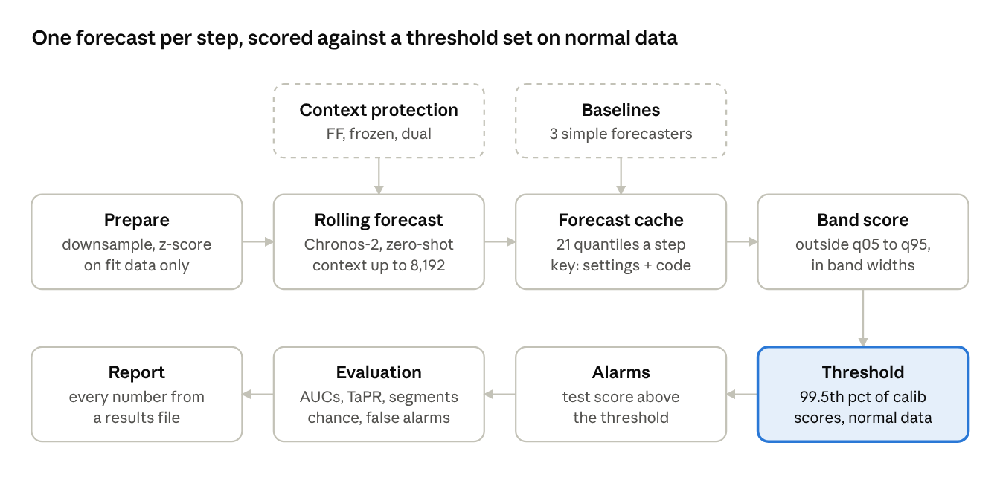
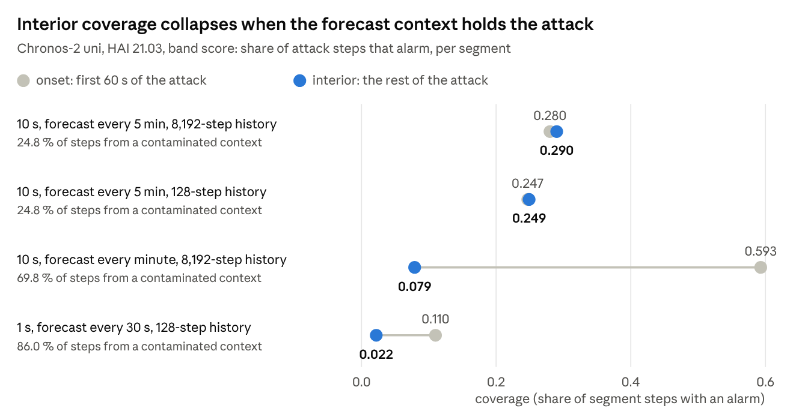
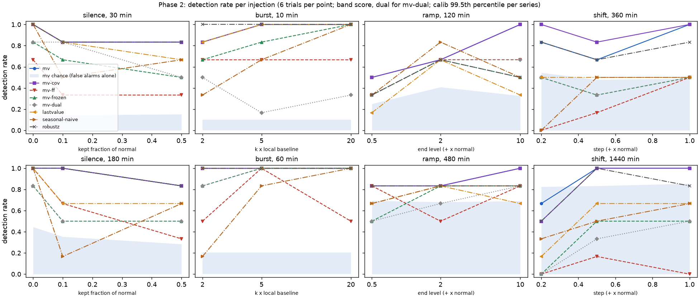

# TSFM security anomaly detection: the full explanation

Oct 21, 2026 · Arthur Rapp

We tested whether a time-series foundation model, used zero-shot, can detect security anomalies in industrial sensor data (HAI) and in enterprise authentication logs (LANL). It sees an anomaly start and end, but it goes blind inside the anomaly once the anomaly is in the forecast's context. On the industrial data this shows only when forecasts restart often relative to the attack length; on the IT logs it shows plainly.

## What we tried to achieve

The goal was to find out what a time-series foundation model (TSFM) can and cannot do for security anomaly detection. A TSFM is a forecaster pretrained on many series that works on new data without training ("zero-shot"). It becomes a detector by comparing each new observation with its forecast: a value far outside the predicted band is suspicious.

That would make detection cheap: no labels, no model per site. The question is whether it also works on attacks that last.

**The hypothesis under test.** A zero-shot TSFM catches the boundaries of an attack but misses its persistent interior. Once attack data enters the forecast's context, the model forecasts it as normal. Every experiment was built to confirm this, refute it or fix it.

**Two phases.**

1. Phase 1: industrial control system (ICS) sensor data, HAI 21.03, with 50 real labelled attacks.
2. Phase 2: IT data, LANL authentication logs, with anomalies we injected ourselves, so the ground truth is controlled.

**Rules we held to.** Strict time-based splits. Normalization statistics and thresholds come only from normal training data. No threshold, horizon or score was tuned on test labels. Every number comes from a file in `results/`, and negative results are reported as plainly as positive ones.

*Note:* the project was planned around Mistral's Timestral models. Their weights licence does not cover our use, so on 2026-10-20 we switched to Amazon's Chronos-2 (Apache 2.0) and ran it through the same pipeline. No Timestral result exists in this project.

## What the papers say

Two 2026 papers by different groups reach the same finding independently: forecast error spikes when an anomaly starts, then collapses inside a long anomaly. Neither cites the other.

|  | Uray et al. 2026 | Lowe, Fung, Bauer 2026 |
| --- | --- | --- |
| Title | Exploring Zero-Shot Foundation Models for Multivariate Time Series Anomaly Detection | On the Application of Time-Series Foundation Models for Detecting Long-Context Anomalies in Industrial Control Systems |
| Venue | EUROCAST 2026 preprint ([arXiv 2607.12454](https://arxiv.org/abs/2607.12454)) | Poster, 2nd ICML Workshop on Foundation Models for Structured Data ([PDF](https://clementfung.github.io/gallery/papers/fmsd26-tsfm.pdf)) |
| Model | TimesFM 1.2.0, one channel at a time | Chronos-2 and Moirai-2.0 |
| Data | SWaT | SWaT, TEP, CTown |
| Window | context 100, horizon 32 | input 32, 64 or 128 steps; horizon 1, 16 or 32 |
| Boundary claim | error spikes at the start and at the end of an anomaly | error spikes at the onset only, then the model follows the attack |
| Fix proposed | none | Forecast Fallback |
| Code | none | none |

**Forecast Fallback (FF).** When a feature's forecast error stays above its 99.5th percentile for 3 consecutive steps, the model's own forecast replaces the observation in the context. The attack then never enters what the model reads. Lowe et al. report a plain Chronos-2 ROC-AUC of 0.239 to 0.517 and an FF ROC-AUC of 0.523 to 0.903, with FF settings chosen on test ROC-AUC.

**ROC-AUC and PR-AUC.** Both measure how well a score ranks attack steps above normal steps, over every possible threshold. Higher is better for both.

- **ROC-AUC** is the chance that a random attack step scores higher than a random normal step. 0.5 is a coin flip, 1.0 is perfect, and a value below 0.5 (such as 0.239) ranks normal steps above attack steps.
- **PR-AUC** is the area under the precision-recall curve. Its chance level is the share of attack steps, 0.024 in our HAI test data. With rare attacks it is the stricter of the two: a high ROC-AUC can still mean that most alarms are false.

**What we can and cannot compare.**

- Neither paper uses HAI, LANL, TaPR or point-adjust, and both tune their F1 threshold on test labels. No number of theirs is comparable with ours; we test their qualitative claim on new data.
- The FF paper states only the trigger (3 steps) and the level (99.5th percentile). Everything else in our FF is an interpretation, and every FF variant name carries `interp`.
- Their windows are short (32 to 128 steps). Ours default to the Chronos-2 maximum of 8,192 steps, which matters for the results.

## How the detector works

The model runs once per window, from history only, and its 21 quantiles go to a cache keyed by the settings and the code. Scores, thresholds, alarms and every evaluation read that cache, never the model, and the threshold comes only from normal calibration data. Context protection changes what the forecast reads; the baselines write their forecasts into the same cache and are scored the same way.

## Phase 1 data: HAI 21.03

HAI 21.03 is a testbed recording of a boiler, a turbine and a water-treatment process with a hardware-in-the-loop simulator, at 1-second resolution ([github.com/icsdataset/hai](https://github.com/icsdataset/hai)). It has 8 files (3 train, 5 test), 79 tags in 4 processes and 50 labelled attacks, all in the test files.

**The attacks are short.** They last 17 s to 422 s, 934 steps in total at 10 s. HAI 21.03 has no attack longer than 10 minutes, so the "persistent interior" is at most 6 minutes here.

**Preparation**, in order:

1. Read every tag as float, labels as integers, and drop the duplicated last row of each file.
2. Drop the 22 tags that are constant over the training and calibration rows.
3. Downsample to 10 s: the mean for continuous signals and actuator commands, the last value for step signals, the maximum for labels (a bin is an attack bin if any second in it is).
4. Z-score each channel with mean and standard deviation from the fit files only (train2 and train3).

**Channel roles.** 44 continuous targets, 7 actuator commands (valve and pump commands) and 6 step covariates that change on fewer than 1 % of steps. The headline set `uni51` forecasts the 44 targets and the 7 commands. The multivariate set `mvlit34` forecasts the targets of each process jointly, with its commands and step signals as covariates.

**Splits.** The files interleave in time (two test files come before any train file), so the split is by file role, not by date. No test row ever fits a statistic or a threshold.

| role | files | 10 s steps scored | used for |
| --- | --- | --- | --- |
| fit | train2, train3 | none | normalization statistics, baseline error quantiles |
| reference | last 24 h of train3 | none | frozen context, seasonal reference day |
| calib | train1, as two 24 h pseudo-files | 16,980 | detection thresholds, FF trigger levels |
| test | test1 to test5 | 39,450 (934 attack) | evaluation only |

The first 1,500 s of every calib and test file are context only and never scored. No attack falls in that warm-up.

## What we built

We built one pipeline that forecasts, scores and evaluates, with every forecast cached so scoring never calls the model again.

**The forecasting loop (rolling).** In every file, a forecast starts every H = 30 steps (5 minutes at 10 s) and covers the next 30 steps. Its context is up to 8,192 steps of the same file before the origin (22.8 hours at 10 s), the Chronos-2 maximum. Each scored step gets exactly one forecast, at a horizon of 1 to 30 steps.

**Two setups.**

- `uni`: each channel forecast alone. We checked that the channels really are independent inside one model call (perturbing one channel leaves the others bit-identical).
- `mv`: the targets of each process (P1, P2, P3) forecast jointly, with commands and step signals as past covariates.

**Three context-protection variants**, all labelled interpretations:

- `ff-interp-block`: Forecast Fallback. After 3 consecutive steps above a feature's calib 99.5th-percentile error, its observations in the context are replaced by the median forecast. Adapted to 30-step blocks, no exit rule.
- `frozen`: every window is forecast from one fixed, clean 8,192-step context taken from the reference day.
- `dual`: the score is the distance between the rolling and the frozen forecast, so it never looks at the observation.

**Scores.** All in units of the fit standard deviation.

- `band` (headline): how far the observation falls outside the 5 %-95 % forecast band, in band widths: max(0, y − q95, q05 − y) / (q95 − q05 + 0.1).
- `mae`: the distance to the median forecast, the score Lowe et al. use.
- `crps`: a score over all 21 forecast quantiles.
- Across channels: the mean of the 3 highest channel scores.

**Threshold.** The 99.5th percentile of each run's own calib scores. By construction 0.5 % of normal steps alarm, about 1.8 false-alarm steps per hour at 10 s.

**Metrics.**

- ROC-AUC and PR-AUC on the continuous score; PR-AUC chance is 0.024 (934 of 39,450 steps).
- Precision, recall and false-alarm steps per hour at the calib threshold.
- TaPR, the official range-based metric code, unmodified. Point-adjusted F1 inflates results and is never a headline.
- **Boundary vs interior:** onset = the first 60 s of an attack, interior = the rest, offset = the 60 s after its end. Coverage = the share of a segment's steps that alarm, always next to its chance level.
- **Origin side:** a step is post-onset if its forecast started after the attack began, so its context holds attack data.
- **cf-onset:** a counterfactual forecast from the clean context at the attack onset, to measure what contamination costs.

**Baselines**, scored exactly like Chronos-2:

| baseline | forecast | band |
| --- | --- | --- |
| `lastvalue` | the last observed value | plus the fit-set change quantiles at each horizon |
| `seasonal-refday` | the reference day at the same clock time | plus day-over-day change quantiles |
| `robustz` | the median of the last hour | plus a MAD-based band |

**Engineering.** One command-line tool (`tsfm-ad`), YAML configs and a pinned model revision. Every forecast is stored with all 21 quantiles in parquet, under a key that hashes the settings and the forecasting source code. Editing that code creates new cache directories instead of mixing results. 119 tests cover the result-critical code: downsampling, splits, normalization, scores, thresholds, segments and the injections.

## The Phase 1 runs

The main matrix ran on 2026-10-20 with Chronos-2 (`amazon/chronos-2`, 119M parameters, float32) on an Apple M5 GPU (MPS). It took 7.56 hours end to end, 99.6 % of it model inference. Scoring and evaluation of a run take seconds, because they read the cache.

| experiment | what ran | question |
| --- | --- | --- |
| 1 | `uni` rolling on `uni51` and `uni57` | Does zero-shot univariate forecasting detect attacks? |
| 2 | `mv` rolling per process (`mv-lit`, `mv-acttgt`) | Does forecasting a process jointly help? |
| 3a, 3b, 3c | Forecast Fallback, frozen, dual on the base setup | Does protecting the context fix the interior? |
| 5 | `lastvalue`, `seasonal-refday`, `robustz` | Does the foundation model beat simple baselines? |
| optional | prepend warm-up, FF with a 30- or 120-step exit | Sensitivity checks |

**The base pick.** The brief asks for "the better of 1 and 2" as the base for experiment 3. `mv-lit` won by 0.00012 PR-AUC (0.39707 against 0.39695), a pick made on test results and in practice a tie.

**CPU against GPU.** Before any headline run, the same smoke forecasts ran on CPU and on MPS. The largest relative gap was 1.37e-4 and every alarm was identical, so all headline runs use MPS.

**Added after the first report**, on 2026-10-20 and 21:

1. Paired block-bootstrap intervals and a comparison at equal false-alarm rates.
2. `chronos-2-small` (28M parameters), to see whether size matters.
3. Lowe et al.'s own setting: 1 s resolution with a 128-step history, plus a 10 s control with the same history.
4. Option B: the headline run with H = 6 instead of 30, so a new forecast starts every minute.

**Not run:** the 1 s run with the full 8,192-step history (about 13 hours) and the model-size experiment on Timestral, which stays paused.

## Phase 1 results

Chronos-2 detects HAI attacks well above chance, but in the headline setting it shows no boundary-versus-interior pattern, and it does not beat a last-value forecast. The paper's pattern appears only when forecasts restart often relative to the attack length.

**Detection on `uni51`** (band score, calib threshold; `metrics.csv`, `tapr.csv`):

| method | ROC-AUC | PR-AUC | TaPR F1 | precision / recall | false-alarm steps per hour |
| --- | --- | --- | --- | --- | --- |
| Chronos-2 `uni` rolling | 0.894 | 0.401 | 0.398 | 0.641 / 0.251 | 1.22 |
| `lastvalue` | 0.891 | 0.412 | 0.554 | 0.537 / 0.370 | 2.79 |
| `seasonal-refday` | 0.748 | 0.395 | 0.384 | 0.443 / 0.472 | 5.18 |
| `robustz` | 0.708 | 0.171 | 0.324 | 0.382 / 0.212 | 2.99 |

- **Univariate and multivariate tie.** On their shared channel set the PR-AUC difference is +0.000 (95 % interval −0.017 to +0.020).
- **The base mv-lit ties the last-value forecast** on PR-AUC on its own channel set (0.397 against 0.402; difference −0.005, interval −0.129 to +0.103). Its edge is fewer false alarms: at 0.5 false alarms per hour it detects 28 attacks against 14. At 5 per hour the last-value forecast covers more attack steps (recall 0.530 against 0.420).
- **Model size does not matter here.** `chronos-2-small` (28M parameters) detects about as many attacks at every equal false-alarm rate (30 to 40 against 31 to 40 of 50) and runs 3.7x faster.
- **Forecast accuracy is not the bottleneck.** On normal data Chronos-2's median error is about 25 % below last-value's (0.388 against 0.508), yet detection ties.

**Boundary vs interior.** In the headline setting, interior coverage (0.290) is not below onset coverage (0.280). The reason is the horizon: with a 5-minute forecast, 33 of 50 attacks lie inside a single forecast issued before they started. Only 24.8 % of attack steps are forecast from a context that holds attack data.

**Where the context does hold the attack, the attack becomes normal.** In the base `mv-lit` run, none of the 231 interior steps forecast from a contaminated context raises an alarm. A clean-context forecast from the attack onset (cf-onset) covers 0.459 of those same steps at the same threshold. Of the 406 interior steps forecast from clean context, 0.367 alarm.

*`REPORT.md` 4.19 and 4.20 · `segments_summary.csv`, `segments_per_attack.csv` · uni rolling, 50 attacks, N = 60 s*

**The paper's setting** (1 s, 128-step history, `REPORT.md` 4.19). Forecasts restart every 30 seconds, and 86.0 % of attack steps come from contaminated contexts. The interior detection rate falls below chance (0.283 against 0.451). A 10 s control with the same 128-step history shows no drop. In this setting Chronos-2 also loses to every baseline: band PR-AUC 0.081 against 0.172 to 0.341.

**Option B** (10 s, H = 6, full history, `REPORT.md` 4.20). A new forecast every minute raises the contaminated share to 69.8 %. It detects 47 of 50 attacks (31 with H = 30), but its ROC-AUC drops from 0.894 to 0.817, and offset coverage falls too (0.027).

**Context protection does not pay at 10 s.** Forecast Fallback (our interpretation) free-runs: 116.5 false-alarm steps per hour against 1.1, PR-AUC 0.208 against 0.397. Frozen (0.190) and dual (0.082) are worse too. In the paper's setting our FF diverged to non-finite values without an exit and with a 30-step exit. With a 120-step exit it alarmed on 17.6 % of normal steps.

## Why Phase 2

HAI could not test the hypothesis well, and the brief's second phase was built to fill the gaps.

1. **The attacks are too short.** At most 7 minutes long, so a 5-minute forecast covers most of an attack from clean context. The interior is rarely contaminated.
2. **50 attacks give wide intervals.** PR-AUC gaps under about 0.1 cannot be resolved.
3. **No control over the anomaly.** Real attacks come in one shape each. We could not vary their length or size to see where detection breaks.
4. **ICS only.** Security teams mostly watch IT telemetry: logins, hosts, network flows.

Phase 2 moves to IT logs and injects its own anomalies, in a grid of types, sizes and durations from 10 minutes to 24 hours. It highlights the "boiling frog" cases the hypothesis says a TSFM misses: a slow ramp and a persistent baseline shift. It also asks two questions of its own: do time-of-day covariates reduce false alarms, and do the real red-team events show up at all?

## Phase 2 data: LANL

The LANL "Comprehensive, Multi-Source Cyber-Security Events" dataset holds 58 days of de-identified enterprise events at 1-second resolution ([Kent 2015](https://csr.lanl.gov/data/cyber1/), doi 10.17021/1179829). The real calendar is undisclosed, so the weekday is unknown.

**Files used.** `auth.txt.gz` (7.6 GB, 1,051,430,459 events), `flows.txt.gz` (1.1 GB) and `redteam.txt.gz` (749 events, all on days 1 to 29). DuckDB streamed the gzip files into per-minute tables; no file was ever loaded whole.

**13 per-minute series from the auth events**, in three groups:

| group | series | definition |
| --- | --- | --- |
| tenant | `auth_total`, `auth_failed`, `users_distinct` | all auth events; failed ones; distinct source users without machine accounts |
| dc | `dc_1` to `dc_5` | events to the 5 busiest destination computers on the fit days ("DC-like": LANL labels no domain controller) |
| host | `host_1` to `host_5` | events from the 5 busiest source computers outside those five |

*Note:* the brief asked for bytes out per host from the flows. Flows are complete only on days 0 to 14; after day 15 the number of source hosts drops from about 8,000 to about 900 a day. So the main study counts auth events per host, and a separate flows sub-study runs on days 0 to 14.

**Transform and splits.** log1p, then a z-score with fit-day mean and standard deviation per series. Fit days 0 to 33 (normalization and top-5 selection), calib days 34 to 40 (thresholds), test days 41 to 57 (17 days, the only days with injections). Each forecast reads up to 8,192 minutes (5.7 days) before its origin.

**Injected anomalies**, on raw counts, in test only. Seeds 0, 1 and 2, each grid point twice per seed, so 6 trials per point and 144 in total. No two injections overlap within a group, with 1 hour blocked before and 6 hours after each.

| type | targets | magnitudes | durations |
| --- | --- | --- | --- |
| silence (a log source drops out) | `auth_total`, `users_distinct`, `dc_*`, `host_*` | 0, 10 % or 50 % of normal kept | 30 min, 3 h |
| burst (brute force) | `auth_failed` | + 2, 5 or 20 times the median of the hour before | 10 min, 1 h |
| ramp (slow rise) | `host_*` | linear to + 50 %, + 200 % or + 1,000 % | 2 h, 8 h |
| shift (baseline shift) | `auth_total`, `dc_*` | + 20 %, + 50 % or + 100 % | 6 h, 24 h |

## The Phase 2 run

The full run took 4.7 hours on 2026-10-21 (09:33 to 14:12) on the same GPU, in stages, with evaluation after each stage so a cut would still leave results.

**Methods.** All forecast at H = 30 minutes with a stride of 30, from up to 8,192 minutes of history.

| method | what it is | explanation |
| --- | --- | --- |
| `mv` | Chronos-2, each group (tenant, dc, host) forecast jointly; the Phase 1 base setup | The plain detector. Every 30 minutes it forecasts the next 30 from the recent past. It adapts fast: once an anomaly is in that past, the anomaly becomes the new normal. |
| `mv-cov` | `mv` plus known-future covariates: time of day (sine and cosine) and day index | The same, but the model is told the clock, so a quiet night or a busy morning is expected rather than flagged. Tests whether calendar knowledge cuts false alarms. The real weekday is unknown in LANL. |
| `mv-ff` | `mv` with Forecast Fallback (our interpretation, no exit) | Tries to keep the anomaly out of the past. After 3 steps of large errors, the real values are replaced by the model's own forecast. With no rule to stop, it keeps replacing and drifts away from reality. |
| `mv-frozen` | 48 fixed forecasts, one per 30-minute time-of-day slot, from the clean minutes ending at that slot on the last fit day (interpretation) | Never adapts. Each half hour of the day always gets the same forecast, made once from a clean day before the test. It sees an anomaly for as long as it lasts, but also every normal change since that day. |
| `mv-dual` | the distance between `mv` and `mv-frozen` | Ignores the observation and compares two forecasts, the adapting one and the frozen one. When they disagree, the recent past has moved away from the clean day, for example because an anomaly entered it. |
| `lastvalue`, `seasonal-naive`, `robustz` | the last value, the value one day earlier, the median and MAD of the last hour; each with fit-day change quantiles as its band | Simple forecasts with no model, as a yardstick: the next value equals the current one, today equals yesterday, or the recent median. If Chronos-2 does not beat them, the foundation model adds little. |

**Scoring.**

- The band score per series, with a threshold at the 99.5th percentile of that series' own calib scores. That alone gives 7.2 false alarms per series-day.
- **Detected** = any alarm on the injected series from the start to 30 minutes after the end. **Latency** = first alarm minus start.
- **Coverage** = the share of injected minutes that alarm; onset = the first 30 minutes, interior = the rest, offset = the 30 minutes after the end.
- **Chance** = the share of windows of the same length, placed on normal minutes, that hold an alarm anyway.
- **False alarms** are counted per series-day on test minutes outside each injection's blocked window.

**Cost** (`results/phase2/runs.csv`, calib plus three seeds): `mv` 3,768 s, `mv-cov` 6,015 s, `mv-ff` 4,756 s (8,352 calls, one origin at a time), `mv-frozen` 63 s. The GPU was shared with option B for most of the run, so these are not latency measurements.

**Device check.** On the smoke days, `mv` on CPU and on GPU differed by at most 6.6e-6 relative over 1,179,360 values, with identical alarms.

## Phase 2 results

On LANL the hypothesis holds plainly. Rolling Chronos-2 (`mv`) alarms at the start and the end of injected anomalies and is blind inside them: interior coverage 0.004, the same as its alarm rate on normal minutes.

**All 144 trials per method** (band score, dual for `mv-dual`; `results/phase2/detections.csv`, `false_alarms.csv`):

| method | detected / trials | chance | onset / interior / offset coverage | false alarms per series-day |
| --- | --- | --- | --- | --- |
| `mv` | 128 / 144 | 0.40 | 0.364 / **0.004** / 0.288 | 6.70 |
| `mv-cov` | 129 / 144 | 0.40 | 0.359 / 0.004 / 0.272 | 6.38 |
| `mv-frozen` | 91 / 144 | 0.24 | 0.376 / 0.313 / 0.023 | 41.83 |
| `mv-dual` | 82 / 144 | 0.19 | 0.183 / 0.340 / 0.231 | 47.48 |
| `mv-ff` | 72 / 144 | 0.28 | 0.321 / 0.312 / 0.210 | 254.95 |
| `lastvalue` | 102 / 144 | 0.22 | 0.316 / 0.018 / 0.284 | 11.03 |
| `seasonal-naive` | 87 / 144 | 0.18 | 0.316 / 0.297 / 0.044 | 42.91 |
| `robustz` | 121 / 144 | 0.35 | 0.549 / 0.080 / 0.392 | 8.83 |

*The forecast band (blue) catches up with a shifted level within one 30-minute forecast, so the score (bottom row) spikes mainly where each injection starts and ends. The frozen band (green) does not follow, but it also sits far from normal levels. Seed 0, the largest magnitude and longest duration per type; `results/phase2/figures/timelines.png`.*

**Boiling frog: a step is seen once, a ramp mostly at its end.**

- A baseline shift is flagged at the step (26 of the 31 detected shifts alarm within 30 minutes) and then accepted for the rest of its 6 or 24 hours (interior coverage 0.002).
- A slow rise of one host's activity has onset coverage 0.069 and interior 0.007. 7 of the 29 detected ramps alarm only when the ramp drops back to normal.
- "Detected" alone says little for long injections: 24-hour shifts are detected 0.89 of the time against a chance level of 0.84.

*Short injections are detected far above chance; for 8-hour ramps and 24-hour shifts, mv's detection rate sits just above its chance level (shaded). 6 trials per point, band score (dual for mv-dual); `results/phase2/figures/detection_curves.png`.*

**Protecting the context buys the interior at a high false-alarm price.** The frozen reference does not adapt, so it covers the interior (0.313), but it alarms on 2.9 % of normal minutes, 6 times `mv`'s rate. Its reference ages over 17 test days. Dual behaves the same way, and Forecast Fallback runs away as in Phase 1 (255 false alarms per series-day).

**An analogy: a guard watching a room.**

- **Rolling model:** the guard looks at the room as it was a moment ago. He notices someone walking in, but after a while the intruder standing in the corner is "part of the room".
- **Protected model:** the guard compares the room with a photo of it, empty, from last week. He notices the intruder the whole time, but also every moved chair, the new plant and the cleaning crew.

**Covariates change little.** With time of day and day index, false alarms fall from 6.70 to 6.38 per series-day and detections rise from 128 to 129. On flow bytes they rise instead (14.26 against 13.75). The true weekday, likely the strongest calendar signal, is not in the data.

**Baselines.** `robustz` (median and MAD of the last hour) detects 121 trials at 8.83 false alarms per series-day, with higher onset (0.549) and interior (0.080) coverage than `mv`. Chronos-2 detects the most at the lowest false-alarm rate, but no equal-false-alarm comparison was built for Phase 2, so the ranking is at different alarm rates.

**Red team.** Around the 20 clusters of real red-team events, `mv` raises 1.9 to 24.2 alarms per hour, against 3.9 expected from the threshold alone. Only one day stands out, and its alarms spread over the whole window rather than the events. 701 of the 749 events come from one computer that is in none of our series. The red team is invisible in these aggregates, as the brief expected.

**Flows sub-study** (33 ramps on flow bytes, days 11 to 14). The exfiltration ramp is invisible to rolling Chronos-2: coverage 0.013 to 0.018 in every segment, detection 23 of 33 against a chance of 0.55. The non-adapting references see it: `mv-frozen` and `seasonal-naive` cover 0.15 of the ramp minutes, at about twice the false alarms. With 4 test days this is a sub-study, not a result to lean on.

## What it means, and the limits

The hypothesis holds, with a condition: a rolling forecaster forgives an anomaly once the anomaly is in its context. Whether that dominates depends on how often the forecast restarts relative to the anomaly's length.

**Conclusions.**

1. **Contamination is real wherever we could test it.** Steps forecast from a context that holds the anomaly rarely alarm: none of 231 such interior steps on HAI at 10 s, 0.087 of such attack steps in option B (0.610 from clean context), and an interior coverage of 0.004 on LANL.
2. **The restart rate decides whether you see it.** Same model, same data: with a 5-minute horizon on 7-minute attacks there is no interior drop; with a restart every minute, or at 1 s, there is.
3. **A zero-shot forecaster is a change detector.** It flags when the level changes, at the start and often at the end, and treats the new level as normal within one forecast.
4. **Every protection we tried costs false alarms.** A reference that does not adapt to the anomaly does not adapt to normal drift either.
5. **Forecast Fallback, as we read it, does not hold up.** Without an exit rule it keeps replacing observations, so the model forecasts from its own forecasts and drifts. False alarms rise from 1.1 to 116.5 steps per hour on HAI, and from 6.70 to 255 per series-day on LANL, where detections fall from 128 to 72 of 144. In the paper's own setting it diverged with a 30-step exit and alarmed on 17.6 % of normal steps with a 120-step exit. The paper states only the trigger and the level, and chose its settings on test ROC-AUC. So this does not refute its FF, but FF needs an exit rule the paper does not give.
6. **Simple baselines are competitive.** A last-value forecast ties Chronos-2 on HAI, a rolling median comes close on LANL, and a 28M model ties the 119M one.

**Threats to validity.**

- One model checkpoint, zero-shot, on one GPU. Nothing here transfers to other foundation models, Timestral included.
- HAI has 50 short attacks, so intervals are wide. LANL's anomalies are synthetic and change one series at a time.
- Forecast Fallback and frozen are our interpretations; they cannot refute the paper's own FF.
- Some choices used test results and are marked as such: the base pick, the segment length N and the calib file.
- The Phase 2 chance levels and segments were added after the run. They are evaluation only and changed no threshold.

**Not run.**

| item | why |
| --- | --- |
| Timestral, all sizes | licence; paused |
| 1 s with the full 8,192-step history | about 13 hours; option B answered its question at 10 s |
| `uni` on LANL | ties `mv` in Phase 1; would not change the finding |
| Equal-false-alarm comparison and intervals for Phase 2 | not built; evaluation only, minutes of CPU |
| HAI 22.04 / 23.05 (real attacks of 8 to 34 minutes) | out of scope so far |

## Sources

**Papers**

- Uray, Messineo, Kwitt, Huber. [Exploring Zero-Shot Foundation Models for Multivariate Time Series Anomaly Detection](https://arxiv.org/abs/2607.12454). EUROCAST 2026 preprint, arXiv 2607.12454.
- Lowe, Fung, Bauer. [On the Application of Time-Series Foundation Models for Detecting Long-Context Anomalies in Industrial Control Systems](https://clementfung.github.io/gallery/papers/fmsd26-tsfm.pdf). 2nd ICML Workshop on Foundation Models for Structured Data, 2026.

**Data**

- [HAI dataset](https://github.com/icsdataset/hai), release 21.03.
- Kent, A. D. [Comprehensive, Multi-Source Cyber-Security Events](https://csr.lanl.gov/data/cyber1/). Los Alamos National Laboratory, 2015, doi 10.17021/1179829.

**Model and metric code**

- [amazon/chronos-2](https://huggingface.co/amazon/chronos-2), revision 29ec3766, Apache 2.0; `chronos-forecasting` 2.3.2. [autogluon/chronos-2-small](https://huggingface.co/autogluon/chronos-2-small) for the size check.
- [TaPR](https://github.com/saurf4ng/TaPR), official implementation, vendored unmodified.

**Project files** (this repository)

- `REPORT.md`: every number in this doc, with its source file; Phase 1 in sections 1 to 9, option B in 4.20, Phase 2 in section 10.
- `PLAN.md`: decisions D1 to D152 and the open questions.
- `results/phase1/` and `results/phase2/`: the result CSVs and figures.
